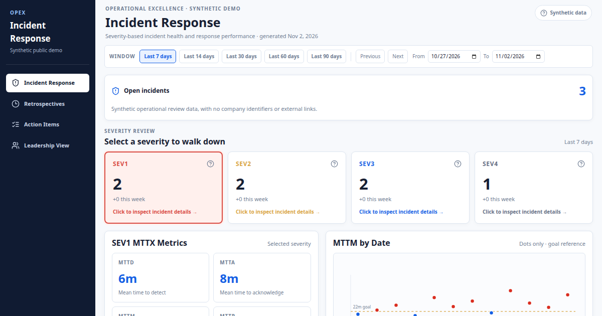

# Incident Response Health Dashboard

A severity-based incident review dashboard for turning incident, retrospective, and follow-up data into an operational review workflow.

> This repository is a GitHub-safe showcase artifact. It uses synthetic sample data and documents the implementation approach without including private FireHydrant, Jira, customer, or employee records.

## Dashboard Preview



## Project Report

[View the Incident Health Dashboard PDF report](docs/incident-health-dashboard-report.pdf)


## What this project demonstrates

The dashboard brings together the operational signals needed for a recurring incident review:

- Incident volume and severity distribution
- Mean Time to Mitigate (MTTM) and severity-specific targets
- Pending and completed retrospectives
- Jira follow-up action items, ownership, age, and status
- Incidents missing direct follow-up work
- Unassigned and aged work that needs leadership attention
- Clear separation between FireHydrant incident IDs and Jira Epic IDs
- A focused walkdown flow for incident response, retrospectives, action items, and leadership views

## Live preview

Open the standalone demo locally or deploy it with GitHub Pages:

```bash
open demo/index.html
```

The demo is a static HTML file with no build step and no external runtime dependency.

## Dashboard views

| View | Purpose |
| --- | --- |
| Incident Response | Review active incidents, severity, status, MTTM, and timeline signals |
| Incident Retros | Track pending retrospectives, completion performance, and SLO compliance |
| Incident Action Items | Review linked Jira work, priority, owner, status, and age |
| Leadership View | Focus on exceptions: aged work, missing owners, and missing follow-ups |
| Greatest Hits | Surface recurring operational patterns and highest-impact themes |

## Core interaction model

1. Select a time window, severity, and team.
2. Start with the KPI row to identify the largest exception.
3. Drill into incidents, retrospectives, or action items.
4. Follow the FireHydrant incident and Jira Epic links separately.
5. Use age and ownership signals to drive the weekly review.

## Data model

The implementation is designed around three source contracts:

- `incidents.csv`: FireHydrant incident records
- `jira_incident_epics.json`: Jira Epics mapped to incidents
- `jira_action_items.json`: Jira follow-up work items

The dashboard treats a normalized `dashboard_state` as the presentation boundary. Source-specific parsing, identity reconciliation, metric calculation, and UI rendering remain separate concerns.

## Important identity rule

A FireHydrant incident number and a Jira Epic key are different identifiers. The UI should show both when available:

```text
FireHydrant incident: FH-1747
Jira Epic: IR-521
```

This prevents incident IDs from being mistaken for Jira issue keys and keeps drill-through links accurate.

## Repository layout

```text
demo/index.html                 Offline static preview
data/sample-dashboard.json     Synthetic data used by the preview
docs/ARCHITECTURE.md            System design and data flow
docs/DATA_CONTRACT.md           Input schemas and identity rules
docs/OPERATING_MODEL.md         Weekly review workflow and metric definitions
docs/ROADMAP.md                 Suggested next steps for productionization
src/dashboard-state.ts          Framework-neutral state and metric example
```

## Deploy with GitHub Pages

1. Create a new GitHub repository.
2. Copy this project into the repository root.
3. Enable **Settings > Pages**.
4. Select the `main` branch and `/demo` as the folder, or move `demo/index.html` to the repository root.
5. Open the generated Pages URL.

For a production implementation, keep operational exports outside the public repository and load them through an authenticated service or a private deployment.

## Origin of the design

The showcase is based on the Incident Response Health work developed in the companion Pod. The original dashboard evolved from a SEV1 proof of concept into a multi-view incident, retrospective, and follow-up review experience, with a reusable dashboard state and explicit data-quality handling.

## License and data notice

Add the license that matches your organization before publishing. Do not commit private operational exports, internal URLs, employee information, customer information, credentials, or proprietary source code without review.
